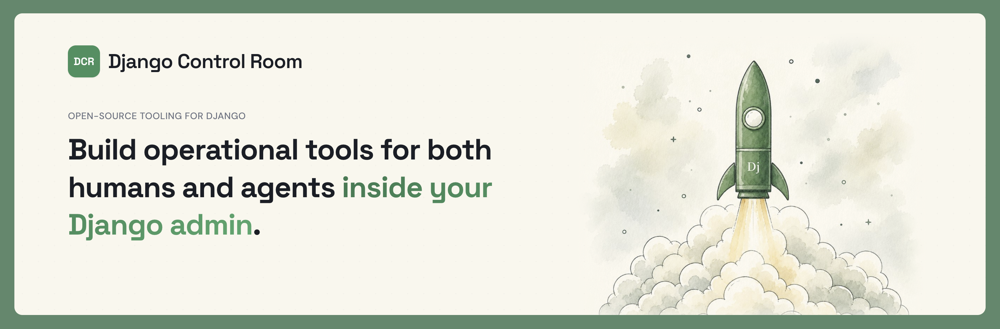

Django Control Room is an open-source framework for building operational software inside the Django admin. Create observability, debugging, monitoring, and management experiences through a flexible plugin architecture.

Build interfaces for both humans and AI agents. Every plugin can expose rich admin experiences alongside MCP tools, allowing developers and agents to inspect, understand, and operate Django applications using the same underlying APIs.

Also Enjoy a growing suite of existing plugins for tools like Redis, django caches, Celery, and others.

### Want to get started and install a bunch of great tools?
- run `pip install dj-control-room[all]` and follow the instructions on the main repo [README](https://github.com/django-control-room/dj-control-room)

### Want to start building your own panels and plugins?
- https://djangocontrolroom.com/build

### Need ideas on what to build or want to suggest a new tool?
- https://djangocontrolroom.com/panels/wishlist

### Come join our community

